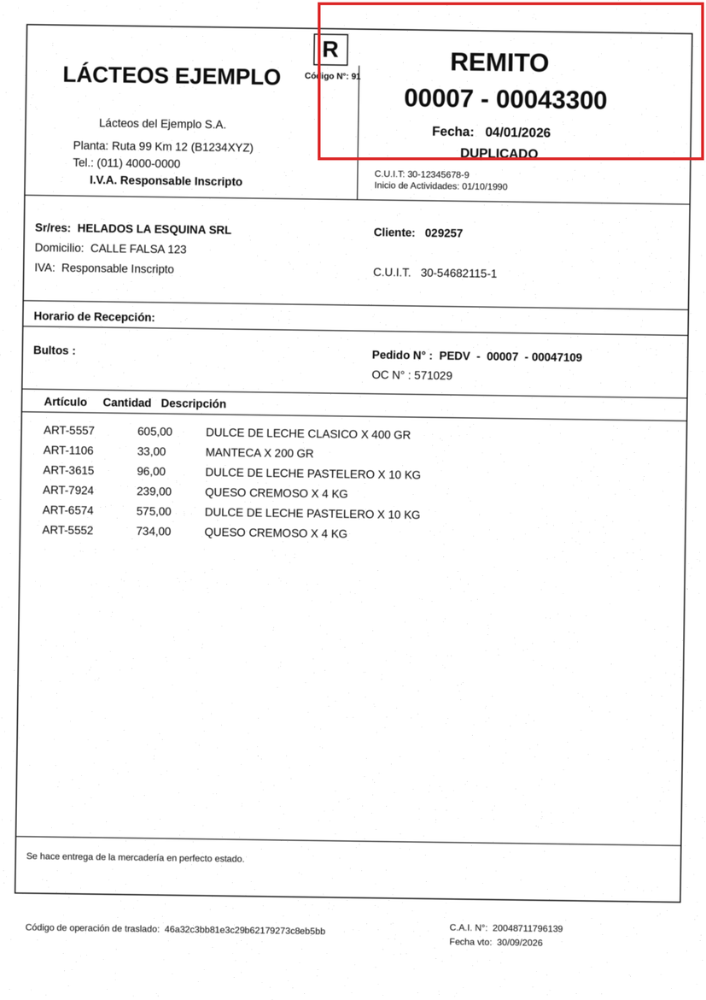
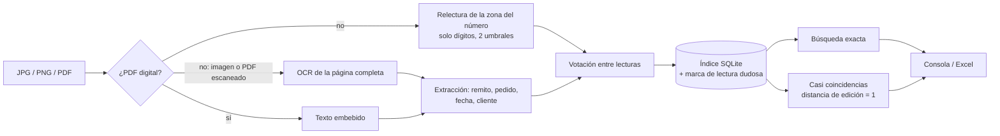

# Buscador de remitos con OCR local

Indexa miles de remitos escaneados (JPG, PNG, PDF) con OCR que corre **100% en la
computadora del usuario**, y permite encontrarlos por número de remito, de a uno o con
una lista entera, con resultados en Excel.

Está en uso en el área contable de una empresa de alimentos: **3 personas** lo usan para
cruzar remitos al cargar facturas, sobre un archivo de **~45.000 remitos por año**.

<p align="center">
  
  <br><sub>Remito <b>sintético</b> (datos inventados). En rojo, la zona que se relee solo con dígitos.</sub>
</p>

## El problema

- Los remitos se escanean y se guardan con nombres que **no tienen relación con el número
  de remito** (`IMG_4521.jpg`, `scan003.pdf`…), sin orden por fecha ni por cliente.
- Para cargar una factura hay que encontrar los remitos que cubre. Hacerlo a mano implica
  abrir archivos uno por uno: **varias horas por cada cruce**.
- Los documentos tienen información comercial sensible (clientes, CUIT, cantidades), así que
  **no se pueden subir a un servicio de IA en la nube**.

## Qué hace

| Acción | Cómo |
|---|---|
| **Indexar** una carpeta (y subcarpetas) | Lee cada archivo con OCR y guarda número de remito, pedido, fecha y cliente en un índice SQLite local. Es incremental: se puede cortar y retomar, y después solo procesa lo nuevo. |
| **Buscar un número** | Acepta `43300`, `00007-00043300`, `00007 - 00043300`… Muestra por separado las coincidencias por **remito** y por **pedido**, y dice `NO ENCONTRADO` cuando no hay. |
| **Buscar una lista** | Arrastrás un Excel con números de remito y devuelve un Excel con dos hojas (por remito / por pedido), una fila por número, con los no encontrados en rojo. Opcionalmente copia los archivos encontrados a una carpeta. |
| **Exportar el índice** | Excel con todos los remitos ordenados por número, con filtros y los de lectura dudosa resaltados para revisar a mano. |

Pensado para usuarios no técnicos: en Windows se instala con un doble clic (Python y
Tesseract vía `winget`) y se usa con archivos `.bat` numerados.

## Cómo funciona



### Decisiones de diseño

- **OCR local (Tesseract) en vez de un LLM o una API en la nube.** Es el requisito
  principal: la información no sale de la PC. Además es gratis y funciona sin internet.
- **Dos lecturas independientes del número + votación.** El OCR de la página completa a
  veces se come o cambia un dígito del número grande del encabezado (`00046241` → `0004624`,
  `46355` → `46395`). Releer solo esa zona, agrandada y con una lista blanca de caracteres
  (`0-9 - /`), es mucho más preciso. Cada lectura vota y la de la zona pesa doble.
- **No confundir remito con pedido.** Los dos números tienen el mismo formato
  (`00007 - 000xxxxx`). El de pedido se identifica por su etiqueta y se descarta como
  candidato a remito, pero queda indexado aparte para poder buscarlo.
- **No confiar en la "capa de texto" de los PDF escaneados.** Muchos escáneres y apps
  (CamScanner, etc.) agregan un texto invisible generado por su propio OCR, que suele ser
  malo. Si la página es básicamente una imagen, se ignora ese texto y se hace OCR propio;
  si el PDF es digital (generado por un sistema), se usa su texto, que es exacto.
- **Marcar en lugar de adivinar.** Cuando las lecturas no coinciden, falta o sobra un
  dígito, el remito queda como **lectura dudosa**. Al buscar un número, los dudosos que
  difieren en **un solo dígito** (distancia de Levenshtein = 1) aparecen como
  *"Posible (revisar)"*. No se amplía a 2 dígitos a propósito: con miles de remitos
  correlativos, eso traería decenas de falsos positivos por búsqueda.
- **Índice incremental y versionado.** Guarda la fecha de modificación de cada archivo y la
  versión de la lógica con que se leyó. Al actualizar el programa, solo se relee lo que la
  nueva versión mejora. Se confirma cada 20 archivos, así que cortar el proceso no pierde
  trabajo.
- **Formato configurable.** Las etiquetas (`Pedido`, `Sr/res`, `Cliente`) y la zona del
  número están en [`config.toml`](config.toml), no en el código.

## Resultados

**En producción:** ~45.000 remitos/año indexados, 3 personas usándolo, y el cruce de remitos para
cargar facturas pasó de horas de abrir archivos a buscar una lista y obtener un Excel.

**Sobre escaneos reales** (7 remitos a 300 dpi con firmas, sellos y anotaciones a mano; no se
publican por confidencialidad):

| Estrategia | Número correcto | Encontrable al buscar |
|---|---|---|
| Solo OCR de la página | 4 / 7 | 4 / 7 |
| Página + zona del número + votación | **6 / 7** | **7 / 7** (el restante, con un dígito tapado por una raya de birome, se marca como dudoso y aparece como posible) |

**Sobre 150 remitos sintéticos** (reproducible con `python tests/evaluar.py --cantidad 150`):

| Calidad del escaneo | Docs | Solo página | Página + zona |
|---|---|---|---|
| Buena | 64 | 100% | 100% |
| Regular (desenfoque) | 39 | 100% | 100% |
| Mala (~150 dpi, tinta gastada, JPEG fuerte) | 29 | 89,7% | **100%** |
| Con un dígito tapado por una raya | 18 | 22,2% | 38,9% |

- Al buscar cada remito por su número: **92,7% coincidencia exacta + 4,0% como "posible"**.
  El 3,3% restante son todos remitos con un dígito tapado.
- Sin coincidencias ajenas: buscar un número nunca devolvió *exacto* un remito equivocado.
- Falsas alarmas de "lectura dudosa" en remitos legibles: 1,5%.
- Velocidad: ~1,2 s por documento por núcleo. La indexación inicial de un año de remitos
  corre de un día para el otro; después solo se procesa lo nuevo.

<p align="center">
  
  <br><sub>El caso más difícil: un dígito tapado. Se marca como dudoso en vez de inventar un número.</sub>
</p>

## Instalación

### Windows (usuarios finales)
1. Descargar el repo (*Code → Download ZIP*) y descomprimirlo.
2. Doble clic en `windows/1_INSTALAR.bat`: instala Python, Tesseract y las librerías.
   El idioma español ya viene incluido en `tessdata/`.
3. Usar los demás `.bat`:

| Archivo | Para qué |
|---|---|
| `2_INDEXAR.bat` | Arrastrar la carpeta de remitos y Enter. |
| `3_BUSCAR.bat` | Buscar un número (o un cliente). |
| `4_BUSCAR_LISTA.bat` | Arrastrar un Excel con números → Excel de resultados. |
| `5_EXPORTAR_EXCEL.bat` | Excel con todo el índice. |

### Desarrollo (Linux / macOS / Windows)
```bash
# Tesseract: apt install tesseract-ocr | brew install tesseract | winget install UB-Mannheim.TesseractOCR
pip install -r requirements.txt
python buscar_remitos.py verificar
```

## Uso por línea de comandos

```bash
python buscar_remitos.py indexar "D:/Remitos"            # recorre subcarpetas; incremental
python buscar_remitos.py buscar 43300
python buscar_remitos.py texto "helados la esquina"
python buscar_remitos.py lista numeros.xlsx --copiar auto # → Resultados_<fecha>.xlsx
python buscar_remitos.py excel                            # → Indice_remitos_<fecha>.xlsx
```

```text
$ python buscar_remitos.py buscar 46390
=== POR NÚMERO DE REMITO ===
Sin coincidencia exacta.

POSIBLES (el número no se pudo leer con seguridad; abrirlos y confirmar):
D:/Remitos/2026/06/scan_0412.jpg
    remito: 00007-00046397   fecha: 10/06/2026   pedido: 00007-00050170
    cliente: HELADOS LA ESQUINA SRL

1 resultado(s).

=== POR NÚMERO DE PEDIDO ===
NO ENCONTRADO
```

## Tests

```bash
pip install pytest
pytest                                   # unitarios + punta a punta con OCR real
python tests/muestras.py demo/ --cantidad 20   # generar remitos sintéticos
python tests/evaluar.py --cantidad 150   # métricas de precisión
```

Los tests y la evaluación usan únicamente **remitos sintéticos** generados por
[`tests/muestras.py`](tests/muestras.py): empresa, clientes, CUIT y números inventados, con
degradaciones de escaneo (rotación, desenfoque, baja resolución, motas, sellos, rayas).

## Estructura

```
remitos/
  config.py      rutas y configuración (config.toml)
  ocr.py         Tesseract: página completa, zona del número, PDF digital vs escaneado
  extraccion.py  regex de remito/pedido/fecha/cliente y votación entre lecturas
  indice.py      SQLite incremental, versionado y migraciones; procesamiento en paralelo
  busqueda.py    búsqueda exacta, por pedido, casi coincidencias y búsqueda por lista
  exportar.py    índice a Excel / CSV
  cli.py         línea de comandos
windows/         instalador y lanzadores .bat para usuarios finales
tests/           generador de remitos sintéticos, evaluación y tests
```

## Limitaciones

- Un dígito tapado por completo no se puede recuperar: se marca para revisión manual.
- Con tinta muy gastada, la fecha puede leerse mal (por ejemplo, 2025 por 2026).
- La zona del número asume que está impreso arriba a la derecha; para otro diseño hay que
  ajustar `zona_numero` en `config.toml`.

## Licencia

MIT. El modelo de idioma en `tessdata/` es del proyecto
[tesseract-ocr/tessdata](https://github.com/tesseract-ocr/tessdata) (Apache 2.0).
