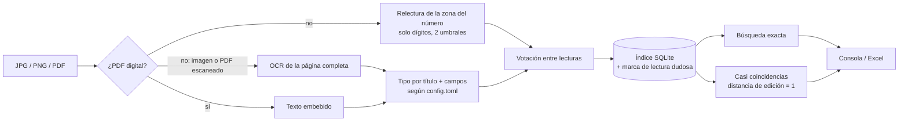
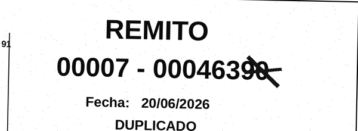

# Buscador de remitos y facturas con OCR local

Indexa miles de remitos escaneados y facturas (JPG, PNG, PDF) con OCR que corre **100% en
la computadora del usuario**, y permite encontrarlos por número (de a uno o con una lista
entera), por fecha, monto o cliente, y obtener los remitos de cada factura, con resultados
en Excel.

Está en uso en el área contable de una empresa de alimentos: **3 personas** lo usan para
cruzar remitos al cargar facturas, sobre un archivo de **~45.000 remitos por año**.

<p align="center">
  
  <br><sub>Remito <b>sintético</b> (datos inventados). En rojo, la zona que se relee solo con dígitos.</sub>
</p>

## El problema

- Los remitos se escanean y se guardan con nombres que **no tienen relación con el número
  de remito** (`IMG_4521.jpg`, `scan003.pdf`…), sin orden por fecha ni por cliente.
- Para cargar una factura hay que encontrar los remitos que cubre. Hacerlo a mano implica
  abrir archivos uno por uno: **varias horas por cada cruce**.
- Los documentos tienen información comercial sensible (clientes, CUIT, cantidades), así que
  **no se pueden subir a un servicio de IA en la nube**.

## Qué hace

| Acción | Cómo |
|---|---|
| **Indexar** una carpeta (y subcarpetas) | Lee cada archivo, reconoce si es remito o factura por su título (el nombre del archivo no importa) y guarda número, fecha, cliente, código de cliente, CUIT, pedido, monto y comprobantes citados en un índice SQLite local. Es incremental: se puede cortar y retomar, y después solo procesa lo nuevo. |
| **Buscar números** | De a uno o una lista (pegada o desde un Excel). Acepta `43300`, `00007-00043300`, `00007 - 00043300`… Distingue coincidencias por **número**, **posibles** (lectura dudosa a un dígito) y por **pedido**, y dice `NO ENCONTRADO` cuando no hay. |
| **Filtrar** | Por tipo (remito/factura), rango de fechas, monto (`<`, `>`, `=`), clientes (nombre parcial, código o CUIT; uno o una lista) y texto. Se combinan entre sí y con los números. |
| **Vincular** | Los remitos de cada factura (por los remitos que cita o por el número de pedido) y la factura de cada remito. Con la lista de facturas de una auditoría salen todos sus remitos. |
| **Excel y copia** | Resultados a Excel (fechas y montos filtrables, dudosos y no encontrados resaltados) y copia de los documentos encontrados a una carpeta. También el índice completo. |

Pensado para usuarios no técnicos: en Windows se instala con un doble clic (Python y
Tesseract vía `winget`) y se usa desde una ventana con botones y filtros.

## Cómo funciona



### Decisiones de diseño

- **OCR local (Tesseract) en vez de un LLM o una API en la nube.** Es el requisito
  principal: la información no sale de la PC. Además es gratis y funciona sin internet.
- **Dos lecturas independientes del número + votación.** El OCR de la página completa a
  veces se come o cambia un dígito del número grande del encabezado (`00046241` → `0004624`,
  `46355` → `46395`). Releer solo esa zona, agrandada y con una lista blanca de caracteres
  (`0-9 - /`), es mucho más preciso. Cada lectura vota y la de la zona pesa doble.
- **No confundir remito con pedido.** Los dos números tienen el mismo formato
  (`00007 - 000xxxxx`). El de pedido se identifica por su etiqueta y se descarta como
  candidato a remito, pero queda indexado aparte para poder buscarlo.
- **No confiar en la "capa de texto" de los PDF escaneados.** Muchos escáneres y apps
  (CamScanner, etc.) agregan un texto invisible generado por su propio OCR, que suele ser
  malo. Si la página es básicamente una imagen, se ignora ese texto y se hace OCR propio;
  si el PDF es digital (generado por un sistema), se usa su texto, que es exacto.
- **Marcar en lugar de adivinar.** Cuando las lecturas no coinciden, falta o sobra un
  dígito, el remito queda como **lectura dudosa**. Al buscar un número, los dudosos que
  difieren en **un solo dígito** (distancia de Levenshtein = 1) aparecen como
  *"Posible (revisar)"*. No se amplía a 2 dígitos a propósito: con miles de remitos
  correlativos, eso traería decenas de falsos positivos por búsqueda.
- **Índice incremental y versionado.** Guarda la fecha de modificación de cada archivo y la
  versión de la lógica con que se leyó. Al actualizar el programa, solo se relee lo que la
  nueva versión mejora. Se confirma cada 20 archivos, así que cortar el proceso no pierde
  trabajo.
- **Dos fuentes únicas de verdad.** Qué datos existen (y cómo se normalizan, filtran,
  muestran y exportan) está definido una sola vez en
  [`campos.py`](programa/buscador/campos.py); cómo se lee cada tipo de documento (título,
  número y una expresión regular por campo) está solo en
  [`config.toml`](programa/config.toml). Agregar un tipo de documento es agregar una sección
  `[tipos.<nombre>]`, sin tocar código; un error en la configuración se informa con la
  sección y la clave.
- **El texto leído se guarda; los datos se recalculan.** El índice guarda el texto de cada
  archivo (y el de la zona del número) y los datos se extraen de ahí con una función pura.
  Si cambia `config.toml`, el índice se actualiza solo a partir del texto guardado, **sin
  volver a hacer OCR** (50.000 documentos en ~5 s).
- **El tipo lo decide el título que aparece primero.** Así una factura que menciona
  "Remito N° …" sigue siendo factura, y los números citados o de pedido nunca se toman como
  número del documento.

## Resultados

**En producción:** ~45.000 remitos/año indexados, 3 personas usándolo, y el cruce de remitos para
cargar facturas pasó de horas de abrir archivos a buscar una lista y obtener un Excel.

**Sobre escaneos reales** (7 remitos a 300 dpi con firmas, sellos y anotaciones a mano; no se
publican por confidencialidad):

| Estrategia | Número correcto | Encontrable al buscar |
|---|---|---|
| Solo OCR de la página | 4 / 7 | 4 / 7 |
| Página + zona del número + votación | **6 / 7** | **7 / 7** (el restante, con un dígito tapado por una raya de birome, se marca como dudoso y aparece como posible) |

**Sobre 150 remitos sintéticos** (reproducible con `python programa/tests/evaluar.py --cantidad 150`):

| Calidad del escaneo | Docs | Solo página | Página + zona |
|---|---|---|---|
| Buena | 64 | 100% | 100% |
| Regular (desenfoque) | 39 | 100% | 100% |
| Mala (~150 dpi, tinta gastada, JPEG fuerte) | 29 | 89,7% | **100%** |
| Con un dígito tapado por una raya | 18 | 22,2% | 38,9% |

- Al buscar cada remito por su número: **92,7% coincidencia exacta + 4,0% como "posible"**.
  El 3,3% restante son todos remitos con un dígito tapado.
- Sin coincidencias ajenas: buscar un número nunca devolvió *exacto* un remito equivocado.
- Falsas alarmas de "lectura dudosa" en remitos legibles: 1,5%.
- Velocidad: ~1,2 s por documento por núcleo. La indexación inicial de un año de remitos
  corre de un día para el otro; después solo se procesa lo nuevo.

<p align="center">
  
  <br><sub>El caso más difícil: un dígito tapado. Se marca como dudoso en vez de inventar un número.</sub>
</p>

## Instalación

### Windows (usuarios finales)
1. Descargar el repo (*Code → Download ZIP*) y descomprimirlo.
2. Doble clic en `Instalar.bat` (solo la primera vez): instala Python, Tesseract y las
   librerías. El idioma español ya viene incluido en `programa/tessdata/`.
3. Doble clic en `Buscador.bat`. Los Excel de resultados y las copias de documentos quedan
   en la carpeta `Resultados/`. En la ventana:
   - **Buscar:** pegar uno o varios números (por ejemplo, una columna copiada de Excel) o
     cargarlos desde un Excel, y/o usar los filtros (tipo, fechas, monto, clientes, texto).
     Con *Incluir remitos/facturas vinculados*, los remitos de cada factura (y viceversa)
     se despliegan debajo de ella. Doble clic en un resultado abre el documento;
     *Resultados a Excel* arma el Excel y *Copiar documentos a una carpeta* los copia a
     `Resultados/Encontrados_<fecha>/` y abre la carpeta.
   - **Indexar carpeta:** en dos pasos. El primero lee solo el encabezado (número, fecha,
     cliente, pedido) y deja todo buscable por número cuanto antes; el segundo completa el
     texto de la página. Se puede pausar o cerrar y sigue donde quedó.
   - **Exportar índice completo a Excel.**

### Desarrollo (Linux / macOS / Windows)
```bash
# Tesseract: apt install tesseract-ocr | brew install tesseract | winget install UB-Mannheim.TesseractOCR
cd programa
pip install -r requirements.txt
python buscador.py verificar
```

## Uso por línea de comandos

```bash
python buscador.py indexar "D:/Comprobantes"           # recorre subcarpetas; incremental
python buscador.py buscar 43300 46390
python buscador.py buscar --lista facturas.xlsx --vinculados --excel
python buscador.py buscar --tipo factura --desde 01/03/2026 --hasta 31/03/2026 --monto ">100000"
python buscador.py buscar --cliente makro --cliente 29257 --texto "dulce de leche"
python buscador.py excel                               # todo el índice → Resultados/Indice_<fecha>.xlsx
```

```text
$ python buscador.py buscar 777 --vinculados
777 | Encontrado: D:/Comprobantes/facturas/fact_0777.pdf
    tipo: Factura   número: 00002-00000777   fecha: 15/03/2026   cliente: HELADOS LA ESQUINA SRL   ...
777 | Remito de factura 00002-00000777: D:/Comprobantes/2026/03/scan_0412.jpg
    tipo: Remito   número: 00007-00043898   fecha: 10/03/2026   ...
```

## Tests

```bash
cd programa
pip install pytest
pytest                                   # unitarios + punta a punta con OCR real
python tests/muestras.py demo/ --cantidad 20   # generar remitos sintéticos
python tests/evaluar.py --cantidad 150   # métricas de precisión
```

Los tests y la evaluación usan únicamente **documentos sintéticos** generados por
[`tests/muestras.py`](programa/tests/muestras.py): empresa, clientes, CUIT y números
inventados; remitos con degradaciones de escaneo (rotación, desenfoque, baja resolución,
motas, sellos, rayas) y facturas en PDF digital.

## Estructura

```
Instalar.bat     instalador para usuarios finales (Windows), solo la primera vez
Buscador.bat     abre la ventana
Resultados/      Excel de resultados y copias de documentos (se crea al usarlo)
programa/
  buscador.py      punto de entrada (línea de comandos y ventana)
  config.toml      tipos de documento (título, número, campos) y parámetros del OCR
  buscador/
    campos.py      los datos de cada documento: tipos, normalización y presentación
    config.py      carga y valida config.toml
    ocr.py         Tesseract: página completa, zona del número, PDF digital vs escaneado
    extraccion.py  tipo de documento, campos y votación entre lecturas (funciones puras)
    indice.py      SQLite incremental en dos pasos, migraciones y recálculo sin OCR
    busqueda.py    filtros, números (exactos, posibles, por pedido) y vinculados
    exportar.py    resultados e índice a Excel
    cli.py         línea de comandos
    gui.py         ventana (tkinter)
  tests/           generador de remitos sintéticos, evaluación y tests
  tessdata/        modelo de español para Tesseract
```

## Limitaciones

- Un dígito tapado por completo no se puede recuperar: se marca para revisión manual.
- Con tinta muy gastada, la fecha puede leerse mal (por ejemplo, 2025 por 2026).
- La zona del número asume que está impreso arriba a la derecha; para otro diseño hay que
  ajustar `zona_numero` en `config.toml`.
- Las **facturas** son de proveedores y cada uno usa su propio diseño. `config.toml` está
  ajustado a los formatos de la muestra (AFIP "Comprobantes en línea" y otros tres): en
  todos sale bien el número y la fecha, pero algunos no imprimen los remitos con un formato
  reconocible y ese campo queda vacío. Para un formato nuevo se agrega una expresión
  regular, y el índice se actualiza sin volver a leer nada.
- Si una factura digital no tiene un "Total" reconocible, se toma su importe más grande. En
  las escaneadas no se adivina: el monto queda vacío y, al filtrar por monto, la factura
  aparece como *"Sin monto (revisar)"* en vez de desaparecer. El monto se guarda sin
  moneda: una factura en dólares se compara como si fueran pesos.
- Los vínculos factura ↔ remito dependen de que la factura imprima los remitos que cubre o
  el número de pedido.

## Licencia

MIT. El modelo de idioma en `programa/tessdata/` es del proyecto
[tesseract-ocr/tessdata](https://github.com/tesseract-ocr/tessdata) (Apache 2.0).
